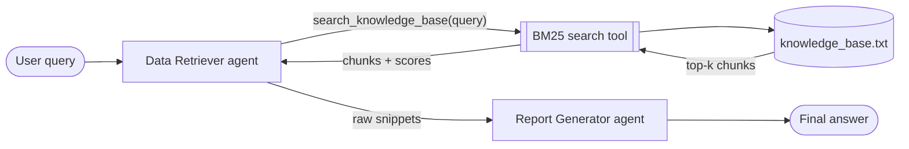

# Agentic RAG Policy Assistant

A two-agent Retrieval-Augmented Generation system built with **LangGraph** and
**LangChain**. You ask a question about (fictional) company policy:

1. The **Data Retriever** agent searches a local knowledge base with a custom BM25
   tool, rewording its query if needed, and returns only the raw relevant chunks.
2. The **Report Generator** agent turns those chunks into a concise, formatted,
   cited answer, using only facts in the chunks. If the knowledge base has no
   answer, it says so plainly.

The default LLM is Anthropic `claude-haiku-5-5`. Azure OpenAI `gpt-5-mini` and
standard OpenAI (both through the **Responses API**) are also supported: the provider
is chosen in one place, `config.py`, with `LLM_PROVIDER` in `.env`.

> **Note on the results in this repo:** the demo output, screenshots and evaluation
> results were all produced with `claude-haiku-5-5`. The Azure and OpenAI paths are
> implemented and covered by offline tests, but have not been run against a live
> endpoint.

## Flow



```
User query
   │
   ▼
Data Retriever ──► search tool ──► knowledge_base.txt
   │   ▲               │
   │   └── snippets ◄──┘      (may search again with reworded keywords)
   ▼
snippets ──► Report Generator ──► final answer (Markdown, cited)
```

The workflow is a LangGraph `StateGraph` with state `{query, snippets, answer}` and
two nodes in strict order: `START → retriever → generator → END`.

## How it works

| Component | File | Notes |
|---|---|---|
| Knowledge base | `knowledge_base.txt` | 9 one-topic paragraphs with concrete numbers, deadlines and approval steps. |
| RAG tool | `retriever_tool.py` | Splits by paragraph into chunks `kb-01` … `kb-09`. Normalises case, strips punctuation, drops stopwords, stems plurals, then ranks with BM25, with a title boost and query synonyms. Returns the top `k=3` chunks above a minimum score, with ids and scores; returns an empty list, never an error, when nothing matches. Exposed as a LangChain `@tool`. |
| Agents | `agents.py` | Both agents are built with LangChain's `create_agent`. |
| Prompts | `prompts.py` | All prompts as named constants. |
| LLM config | `config.py` | The one place to choose the provider (`azure`, `openai` or `anthropic`) and each agent's reasoning effort. |
| Orchestration and CLI | `main.py` | The LangGraph `StateGraph` plus a `rich` CLI that streams the answer. |
| Grounding check | `grounding.py` | Flags answers that cite unretrieved chunks or use numbers absent from the snippets. |
| Evaluation | `evaluate.py`, `evaluation/` | Labelled questions with retrieval metrics, and an optional end-to-end run. |

Design decisions worth noting:

- **The retriever always searches.** A `wrap_model_call` middleware forces the
  first model call to use `search_knowledge_base`. After that the agent must either
  search again or submit a structured `RetrievalResult` (a list of relevant chunk
  ids). It can never reply with free text, so it cannot answer the question itself.
- **Snippets are the raw source text.** The agent only chooses *which* chunks are
  relevant. The chunk text is taken verbatim from the tool's artifact, so the model
  never paraphrases it on the way to the generator. Ids the model invents are
  ignored.
- **Two layers of relevance.** BM25 filters by score. The agent then drops chunks
  that only share a keyword. For example, "pets in the office" matches *Remote Work*
  on the word "office", and the agent removes it.
- **No answer without evidence.** If no snippets survive, the generator node returns
  the fixed "not in the knowledge base" message without calling the LLM. The
  generator prompt also covers irrelevant or partial snippets.
- **Own BM25 instead of `rank_bm25`.** The Okapi IDF used by `rank_bm25` turns
  negative for terms in more than half the documents, which is common in a 9-paragraph
  corpus and breaks a score threshold. This implementation uses the Lucene IDF,
  which is always positive.
- **Title boost and query synonyms.** Words in a chunk's topic title count extra, so
  the paragraph *about* a topic outranks paragraphs that only mention it. Everyday
  words the policies never use ("vacation", "WFH", "per diem", "MFA") expand to the
  policy vocabulary at half weight, so the first search usually succeeds.
- **Answers are checked after generation.** `grounding.py` verifies, without a second
  LLM call, that every cited chunk id was actually retrieved and every number in the
  answer appears in a snippet. The CLI prints PASS or a warning under each answer.
- **Speed.** The Data Retriever only picks keywords and filters chunks, so it runs at
  `minimal` reasoning effort; the Report Generator runs at `low`. The retriever's
  model does not stream. The generator's tokens stream to the terminal as they
  arrive, through LangGraph's `messages` stream mode.

## Evaluation

```bash
python evaluate.py          # retrieval only, no API key needed
python evaluate.py --e2e    # also run every question through both agents
```

`evaluation/cases.json` holds 28 labelled questions (24 answerable, 4 not in the
knowledge base). The retriever was tuned on this set, so `evaluation/holdout.json`
(14 questions) was written afterwards and scored once without further tuning.

| Configuration | cases.json Hit@1 | Recall@3 | MRR | holdout.json Hit@1 | Recall@3 | MRR |
|---|---|---|---|---|---|---|
| Plain BM25 | 92% | 99% | 0.95 | — | — | — |
| + stopwords, title boost, synonyms (final) | 100% | 100% | 1.00 | 92% | 100% | 0.96 |

Both sets are small and hand-written, so treat these numbers as a regression guard
(`tests/test_evaluate.py` enforces them), not a benchmark. On the out-of-KB questions,
BM25 alone returns nothing for half of them. The rest share a keyword with some
policy ("office", "leave"), and the Data Retriever agent has to filter those out.
`--e2e` measures that: an answerable question passes if the answer cites an expected
chunk and passes the grounding check, and an out-of-KB question passes if the system
says the knowledge base has no answer.

Latest `--e2e` run, with `claude-haiku-5-5`:
**41/42 passed**. All 6 out-of-KB questions were declined. The one failure is
"How much sick pay do I get?": the answer added 15 + 30 into a "45 days" total
that the policy never states. The grounding check flags this on purpose, because it
only accepts numbers that appear in the sources or the question.

## Setup

Requires Python 3.11 or newer.

```bash
python -m venv .venv
.venv\Scripts\activate          # Windows
# source .venv/bin/activate     # macOS / Linux
pip install -r requirements-dev.txt
copy .env.example .env          # Windows (cp on macOS / Linux)
```

Edit `.env` and set `ANTHROPIC_API_KEY` (from console.anthropic.com). Optionally set
`ANTHROPIC_MODEL` (default `claude-haiku-5-5`). Claude runs without extended
thinking, because the Anthropic API does not allow the retriever's forced first tool
call while thinking is on.

To use another provider, set `LLM_PROVIDER` and that provider's variables:

| `LLM_PROVIDER` | Variables |
|---|---|
| `azure` | `AZURE_OPENAI_ENDPOINT`, `AZURE_OPENAI_API_KEY`, `AZURE_OPENAI_DEPLOYMENT` (e.g. `gpt-5-mini`), `AZURE_OPENAI_API_VERSION` (default `2025-04-01-preview`; the Responses API needs `2025-03-01-preview` or later) |
| `openai` | `OPENAI_API_KEY`, optionally `OPENAI_MODEL` (default `gpt-5-mini`) |

For these two, `RETRIEVER_REASONING_EFFORT` (default `minimal`) and
`GENERATOR_REASONING_EFFORT` (default `low`) set each agent's reasoning effort. If
your deployment rejects `minimal`, set the retriever to `low`.

## Run

```bash
python main.py                                         # run the 4 demo queries
python main.py "How many days of annual leave do I get?"
python main.py --search-only                           # BM25 tool only, no API key needed
```

For each query the CLI prints the question, then a table of retrieved chunk ids with
their BM25 scores as soon as the retriever finishes. It then streams the final answer
and ends with the grounding-check result.

## Tests and lint

```bash
pytest
ruff check .
ruff format --check .
```

The tests need no API key.

- `tests/test_retriever.py` covers chunking, tokenisation, ranking, thresholds,
  synonyms, title boost and the LangChain tool.
- `tests/test_workflow.py` runs the real LangGraph workflow with a scripted fake chat
  model. It checks node order, the forced first search, snippet selection, the
  not-found path and answer streaming.
- `tests/test_grounding.py` covers the grounding checker.
- `tests/test_evaluate.py` covers the metrics and holds retrieval quality at the
  levels in the table above.
- `tests/test_config.py` covers settings, the provider swap and per-agent reasoning
  effort.

## Screenshots

Screenshots of the demo run (with `claude-haiku-5-5`) are in [`screenshots/`](screenshots/):

| Query | Screenshot |
|---|---|
| International travel | `screenshots/01-international-travel.png` |
| Annual leave | `screenshots/02-annual-leave.png` |
| Travel expenses | `screenshots/03-travel-expenses.png` |
| Pets in the office (not in KB) | `screenshots/04-not-in-kb.png` |
